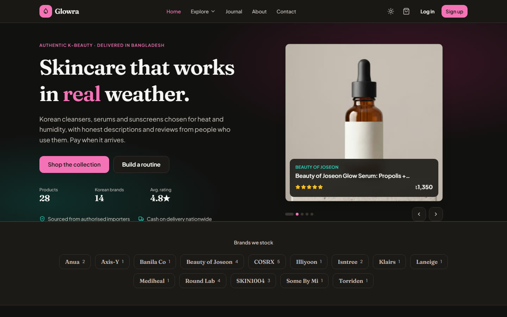

# Glowra (Client)

**Glowra** is a skincare marketplace: shoppers explore and buy skincare products, leave reviews and track orders; sellers list their own products; admins run the store from a dashboard with live charts. This is the Next.js frontend. The backend is an Express + MongoDB API.

- **Live website:** https://glowra-client.vercel.app
- **Server repository:** https://github.com/hamsakib/glowra-server
- **Live API:** https://glowra-server.vercel.app



## Demo credentials

| Role | Email | Password |
| --- | --- | --- |
| User | user@glowra.dev | User@1234 |
| Admin | admin@glowra.dev | Admin@1234 |

The login page also has one-click **Demo User** and **Demo Admin** buttons that fill these in.

## Key features

- **Home page:** sticky navbar with profile dropdown, interactive hero, live statistics from the backend, categories, featured products, how it works, testimonials, blog preview, FAQ, newsletter and footer
- **Explore page:** search, category and price filters, sorting and server-side pagination, skeleton loaders while loading
- **Product details:** public page with image gallery, overview, specifications, reviews and ratings, related products
- **Authentication:** register and login with validation, JWT stored and sent with requests, protected routes, role-based access (user and admin)
- **User dashboard:** overview cards, charts, my listings (create, edit, delete with image upload), orders, profile (photo upload, details, password change) and settings
- **Admin dashboard:** overview cards, bar, line and pie charts from real data, manage users, products, orders, categories, contact messages, reports and settings, with paginated, filterable, sortable data tables
- **Cart and checkout** for placing orders
- **Extra pages:** About, Contact (saved to the database), Blog, Help, Privacy Policy, Terms
- **Design:** light and dark mode, 3-colour palette, consistent spacing and radius, reusable Button, Input, Card, Badge, Modal, Table and Dropdown components, fully responsive

## Tech stack

Next.js 16 (App Router) · React 19 · Tailwind CSS 4 · TanStack Query · React Hook Form + Zod · Recharts · next-themes · lucide-react · sonner

## Dependencies

| Package | Version |
| --- | --- |
| `@hookform/resolvers` | ^5.9.2 |
| `@tanstack/react-query` | ^5.104.5 |
| `clsx` | ^2.1.1 |
| `lucide-react` | ^1.61.0 |
| `next` | 16.4.2 |
| `next-themes` | ^0.4.6 |
| `react` | 19.3.0 |
| `react-dom` | 19.3.0 |
| `react-hook-form` | ^7.90.0 |
| `recharts` | ^3.10.1 |
| `sonner` | ^2.0.8 |
| `zod` | ^4.6.7 |

Development:

| Package | Version |
| --- | --- |
| `@tailwindcss/turbopack` | ^4 |
| `eslint` | ^9 |
| `eslint-config-next` | 16.4.2 |
| `tailwindcss` | ^4 |

## Run locally

```bash
git clone https://github.com/hamsakib/glowra-client.git
cd glowra-client
npm install
cp .env.example .env.local   # point NEXT_PUBLIC_API_URL at the API
npm run dev                  # http://localhost:3000
```

Start the API first (see the server repository).

### Environment variables

| Name | Description |
| --- | --- |
| `NEXT_PUBLIC_API_URL` | URL of the Glowra API |
| `NEXT_PUBLIC_SITE_URL` | public URL of this site |
